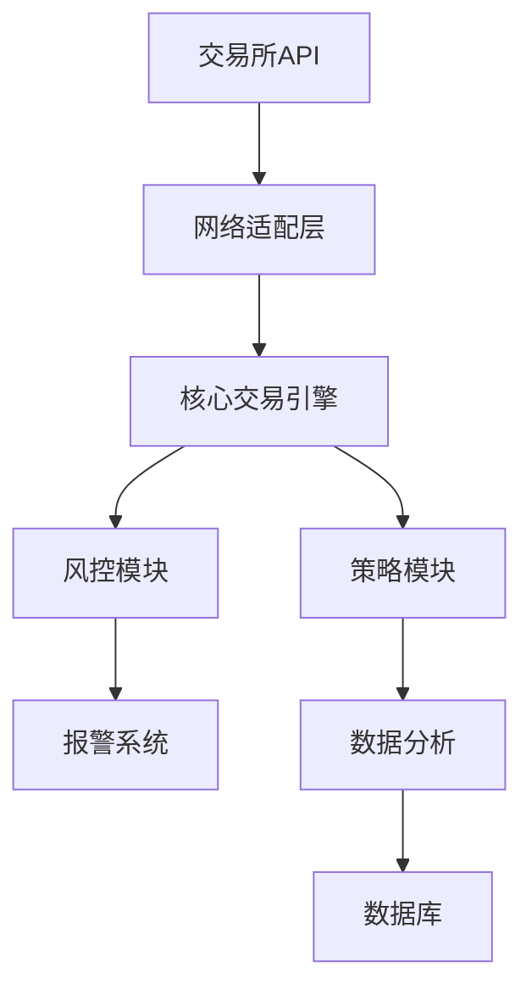

# 工业级加密货币套利交易系统技术文档

## 1. 系统架构设计

### 1.1 整体架构图


### 1.2 组件说明
1. **网络适配层**
   - WebSocket连接管理（指数退避重连机制）
   - REST API请求签名（HMAC-SHA256）
   - 多路复用连接池（支持10+交易所并行连接）

2. **核心交易引擎**
   - 事件驱动架构（Epoll/kqueue）
   - 订单生命周期管理（FSM状态机）
   - 纳秒级时间戳同步（PTP协议）

## 2. 开发环境配置

### 2.1 硬件要求
| 组件 | 规格要求 |
|------|----------|
| CPU | Xeon Gold 6248R (3.0GHz, 24核) |
| 内存 | 128GB DDR4 ECC |
| 存储 | Intel Optane SSD 1TB (3D XPoint) |
| 网络 | 10Gbps专用链路+5G备用 |

### 2.2 软件依赖
```bash
# 基础环境
gcc-12.2.0
cmake-3.25.1
boost-1.81.0

# 关键库
git clone https://github.com/your-repo/crypto-api-sdk.git
cd crypto-api-sdk && mkdir build && cd build
cmake -DUSE_AVX2=ON -DENABLE_HARDWARE_CRC=ON ..
make -j24
```

## 3. 核心算法实现

### 3.1 价差计算模块
```cpp
class SpreadCalculator {
public:
    void update(const OrderBook& book) {
        // 使用AVX2指令集加速计算
        __m256d ask_vec = _mm256_load_pd(book.asks);
        __m256d bid_vec = _mm256_load_pd(book.bids);
        m_spread = _mm256_sub_pd(ask_vec, bid_vec);
        
        // 原子操作保证线程安全
        atomic_store(&m_valid_spread, true);
    }
private:
    alignas(32) __m256d m_spread;  // 32字节内存对齐
    atomic<bool> m_valid_spread{false};
};
```

### 3.2 移动平均滤波器
```cpp
class ExponentialMovingAverage {
public:
    void update(double price) {
        m_ema = m_alpha * price + (1 - m_alpha) * m_ema;
        // 防止浮点误差累积
        if(++m_count % 1000 == 0) {
            m_ema = std::fma(m_alpha, price, (1-m_alpha)*m_ema);
        }
    }
private:
    double m_alpha = 0.2;  // 平滑因子
    double m_ema = 0;
    uint64_t m_count = 0;
};
```

## 4. 交易所API集成

### 4.1 WebSocket连接管理
```cpp
class WSConnection {
public:
    void connect() {
        m_ws.set_message_handler([this](auto msg) {
            m_queue.push(msg);  // 无锁队列
            m_cv.notify_one();
        });
        
        // 心跳检测
        m_timer.expires_after(5s);
        m_timer.async_wait([this](auto...){ send_ping(); });
    }

private:
    websocketpp::client m_ws;
    moodycamel::ConcurrentQueue<Message> m_queue;
    asio::steady_timer m_timer;
    std::condition_variable m_cv;
};
```

### 4.2 订单执行流程
1. **预提交检查**
   - 余额验证
   - 价格滑点校验
   - 交易所限频控制

2. **执行阶段**
   ```python
   def execute_order(order):
       with distributed_lock(f"order_{order.id}"):  # 分布式锁
           if not risk_engine.validate(order):
               raise RiskLimitExceeded
           
           try:
               resp = api.post_order(order)
               audit_log.log(order, resp)
           except APIError as e:
               circuit_breaker.record_failure()
               raise
   ```

## 5. 风控系统设计

### 5.1 实时风控矩阵
| 指标 | 阈值 | 动作 |
|------|------|------|
| 单笔最大亏损 | 2%净值 | 强平 |
| 每分钟订单数 | 50次 | 限流 |
| 回撤超过 | 5% | 暂停 |
| 网络延迟 | >100ms | 切换机房 |

### 5.2 熔断机制实现
```cpp
class CircuitBreaker {
public:
    void check() {
        if(m_failures > m_threshold) {
            m_state = State::OPEN;
            m_opened_time = steady_clock::now();
            alert_service.send("Circuit Breaker Tripped!");
        }
    }
    
    bool allow_request() const {
        return m_state == State::CLOSED || 
              (m_state == State::HALF_OPEN && 
               m_test_counter++ % 2 == 0);
    }

private:
    enum class State { CLOSED, OPEN, HALF_OPEN };
    std::atomic<State> m_state{State::CLOSED};
    std::atomic<uint32_t> m_failures{0};
};
```

## 6. 部署方案

### 6.1 Kubernetes部署配置
```yaml
apiVersion: apps/v1
kind: Deployment
spec:
  replicas: 3
  strategy:
    rollingUpdate:
      maxSurge: 1
      maxUnavailable: 0
  template:
    spec:
      containers:
      - name: trader
        image: registry.example.com/trader:v1.2.3
        resources:
          limits:
            cpu: "8"
            memory: 16Gi
          requests:
            cpu: "4" 
            memory: 8Gi
        envFrom:
        - configMapRef:
            name: trading-config
```

### 6.2 监控指标
```prometheus
# Metrics
trader_order_latency_seconds_bucket{exchange="binance",le="0.1"} 42
trader_spread_value{base="BTC",quote="USDT"} 12.34
trader_risk_exposure{strategy="arbitrage"} 0.23

# Alert Rules
- alert: HighOrderLatency
  expr: trader_order_latency_seconds{quantile="0.99"} > 0.5
  for: 5m
```

## 7. 性能优化

### 7.1 低延迟优化技巧
1. **内存管理**
   - 使用jemalloc替代默认分配器
   - 对象池化关键数据结构

2. **网络栈优化**
   ```bash
   # 内核参数调优
   sysctl -w net.core.rmem_max=16777216
   sysctl -w net.ipv4.tcp_fastopen=3
   ethtool -C eth0 rx-usecs 10 tx-usecs 10
   ```

3. **CPU亲和性**
   ```cpp
   void set_cpu_affinity() {
       cpu_set_t cpuset;
       CPU_ZERO(&cpuset);
       CPU_SET(2, &cpuset);  // 专用核
       pthread_setaffinity_np(pthread_self(), sizeof(cpu_set_t), &cpuset);
   }
   ```

## 8. 灾难恢复

### 8.1 数据持久化方案
```cpp
class JournalService {
public:
    void log_order(const Order& order) {
        // 双写策略：本地SSD + 远程存储
        m_local_journal.write(order);
        m_kafka_producer.send("order-topic", order);
        
        // 定期校验
        if(++m_counter % 100 == 0) {
            verify_consistency();
        }
    }
};
```

### 8.2 故障转移流程
1. 检测到主节点故障（心跳超时）
2. 从ZooKeeper选举新主
3. 从共享存储恢复状态
4. 重放最后100条交易日志
5. 接管VIP继续服务

---

> **文档版本控制**  
