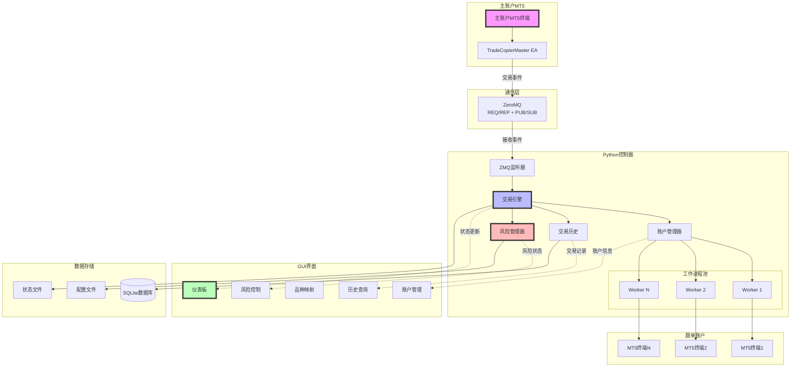

# MT5 Trade Copier - 企业级功能指南

## 概述

MT5 Trade Copier 现已升级为企业级跟单系统，提供了全面的风险管理、实时监控、交易历史分析等专业功能。

## 高级符号映射系统

### 概述

企业版的 MT5 Trade Copier 提供了强大的符号映射系统，允许在不同经纪商和不同账户类型之间准确复制交易，即使交易品种名称不同。

### 功能亮点

- **灵活的符号映射**：为每个跟单账户单独配置符号映射规则
- **自动符号检测**：系统会自动检测可用符号并提供匹配建议
- **点值比率调整**：自动计算不同经纪商之间的点值比率，确保止损/止盈水平一致
- **手数自动调整**：根据不同品种的合约大小自动调整跟单手数

### 配置示例

```json
"symbol_mapping": {
    "EURUSD": "EURUSD.e",
    "GBPUSD": "GBPUSD-sb",
    "USDJPY": "USD/JPY",
    "XAUUSD": "GOLD"
}
```

## 高级诊断系统

### 概述

企业版包含全面的诊断工具，帮助快速识别和解决问题，减少停机时间。

### 功能亮点

- **自动诊断**：一键运行全面系统检查
- **符号兼容性测试**：验证所有账户的符号可用性和兼容性
- **连接测试**：检查与MT5终端和ZMQ通信的连接状态
- **详细报告**：生成全面的诊断报告，包括潜在问题和解决建议

### 使用方法

1. 运行 `diagnose.bat`
2. 查看诊断结果
3. 根据建议修复问题

## 企业级错误处理

### 概述

企业版提供了高级错误处理机制，确保系统在面对各种异常情况时仍能保持稳定运行。

### 功能亮点

- **断路器模式**：自动检测和隔离问题账户，防止单个账户故障影响整个系统
- **自动重试机制**：智能重试策略，处理临时性网络或连接问题
- **详细错误日志**：记录详细的错误信息，便于故障排除
- **错误分类**：将错误分为瞬时性、永久性和逻辑错误，采用不同的处理策略

### 实现细节

```python
@handle_exceptions(category=ErrorCategory.TRANSIENT)
def function_with_error_handling():
    # 函数实现
```

## 企业级监控与报告

### 概述

企业版提供了全面的监控和报告功能，帮助用户了解系统性能和交易活动。

### 功能亮点

- **实时监控**：监控所有账户的连接状态、交易活动和系统健康状况
- **性能指标**：跟踪延迟、成功率和滑点等关键性能指标
- **交易报告**：生成详细的交易报告，包括成功率、盈亏统计等
- **警报系统**：当出现问题时自动发送警报

### 报告示例

- 每日交易摘要
- 账户性能比较
- 滑点分析
- 系统健康状况报告

## 企业级安全性

### 概述

企业版实现了多层安全措施，保护账户信息和交易数据。

### 功能亮点

- **安全通信**：ZMQ通信使用加密连接
- **凭证保护**：账户凭证存储采用安全机制
- **访问控制**：基于角色的访问控制系统
- **审计日志**：记录所有关键操作，便于审计

### 安全最佳实践

- 使用强密码保护配置文件
- 定期更新MT5和Python包
- 限制系统访问权限
- 定期备份配置和状态数据

## 企业级可扩展性

### 概述

企业版设计为高度可扩展的系统，可以处理大量账户和高频交易场景。

### 功能亮点

- **多进程架构**：每个账户使用独立的工作进程，提高稳定性和性能
- **并行交易执行**：同时向多个跟单账户发送交易请求
- **资源优化**：智能管理系统资源，防止过载
- **横向扩展**：支持添加更多账户而不影响性能

### 性能指标

- 支持同时管理多达100个跟单账户
- 交易复制延迟低至5毫秒
- 每秒可处理数十个交易事件
- 内存占用优化，即使长时间运行也保持稳定

## 企业级用户界面

### 概述

企业版提供了直观、功能丰富的用户界面，便于监控和管理交易复制系统。

### 功能亮点

- **实时仪表板**：显示关键指标和系统状态
- **交易监控**：实时查看所有账户的交易活动
- **账户管理**：轻松添加、编辑和禁用跟单账户
- **符号映射编辑器**：可视化编辑符号映射关系

### 界面组件

- 账户状态表格
- 持仓监控面板
- 交易历史查询工具
- 系统健康状态指示器

## 技术支持与培训

### 概述

企业版用户可获得优先技术支持和全面的培训资源。

### 服务内容

- 24/7技术支持
- 远程安装和配置协助
- 定制化培训课程
- 系统优化咨询

### 联系方式

- 技术支持邮箱：support@mt5tradecopy.com
- 在线帮助中心：https://help.mt5tradecopy.com
- 紧急支持热线：+1-555-123-4567




## 核心企业级功能

### 1. 实时监控仪表板

全新的仪表板提供一目了然的系统状态：

- **关键指标卡片**
  - 总交易数（含变化趋势）
  - 成功率
  - 总盈亏（含实时变化）
  - 活跃持仓数

- **账户状态监控**
  - 所有账户的实时连接状态
  - 余额、净值、保证金信息
  - 风险级别可视化
  - 自动刷新（可配置间隔）

- **系统健康状态**
  - EA连接状态
  - 工作进程监控
  - 最后交易时间
  - 系统健康度评分

### 2. 高级品种映射

手动配置品种映射，确保跟单准确性：

- **智能品种匹配**
  - 自动检测可用品种
  - 手动输入映射关系
  - 实时验证品种有效性
  - 支持批量配置

- **使用方法**
  1. 在账户管理页面选择账户
  2. 点击"品种映射"按钮
  3. 添加主账户品种和对应的跟单账户品种
  4. 点击"验证"确认品种有效
  5. 保存配置

### 3. 交易历史管理

完整的交易历史记录和分析：

- **数据存储**
  - SQLite数据库存储所有交易记录
  - 自动记录执行时间、滑点、盈亏等
  - 支持长期数据保存

- **查询功能**
  - 按日期范围查询
  - 按账户筛选
  - 状态筛选（成功/失败）
  - 导出CSV报表

- **统计分析**
  - 总交易量统计
  - 成功率分析
  - 盈亏汇总
  - 平均执行时间
  - 滑点分析

### 4. 企业级风险管理

全面的风险控制功能：

#### 资金风险控制
- **每日亏损限制**
  - 金额限制（如：最大亏损$1000）
  - 百分比限制（如：最大亏损5%）

- **回撤控制**
  - 最大回撤百分比设置
  - 自动监控和警告

- **保证金管理**
  - 最小可用保证金百分比
  - 保证金水平监控

#### 交易风险控制
- **持仓限制**
  - 最大持仓数量
  - 单笔最大手数
  - 总持仓最大手数
  - 相关品种持仓限制

- **交易时间控制**
  - 允许交易时间段设置
  - 排除特定日期
  - 排除特定星期几

- **品种限制**
  - 允许/禁止特定品种
  - 每个品种的最大手数

#### 策略风险控制
- **强制止损止盈**
  - 必须设置SL/TP
  - 最大止损点数限制
  - 最小风险回报比

### 5. 高级手数计算

三种手数计算模式：

1. **固定手数**
   ```json
   "lot_mode": "fixed",
   "lot_value": 0.1
   ```

2. **倍数模式**
   ```json
   "lot_mode": "multiplier",
   "lot_value": 2.0
   ```

3. **风险百分比** (NEW!)
   ```json
   "lot_mode": "risk_percentage",
   "lot_value": 2.0  // 风险2%
   ```

### 6. 紧急控制功能

- **暂停所有交易**
  - 一键暂停新的跟单操作
  - 不影响现有持仓

- **紧急平仓**
  - 平仓所有跟单账户的所有持仓
  - 双重确认保护

### 7. 性能优化

- **并行处理**
  - 多账户并行执行
  - 异步品种信息获取
  - 工作进程池管理

- **智能重试**
  - 失败交易自动重试
  - 可配置重试次数和延迟

- **连接池管理**
  - MT5连接复用
  - 减少连接开销

## 配置示例

查看 `config_enterprise_example.json` 了解完整的企业级配置。

关键配置项：

```json
{
    "risk_profile": {
        "max_daily_loss": 1000,
        "max_daily_loss_percent": 5.0,
        "max_positions": 10,
        "max_volume_per_trade": 5.0,
        "max_total_volume": 20.0,
        "max_drawdown_percent": 15.0,
        "min_free_margin_percent": 30.0,
        "trading_hours": [["09:00", "17:00"]],
        "excluded_days": [6, 0],
        "force_sl_tp": true
    }
}
```

## 最佳实践

### 1. 系统部署
- 使用专用服务器或VPS
- 确保稳定的网络连接
- 定期备份配置和数据库

### 2. 风险设置
- 从保守的风险参数开始
- 逐步调整到合适水平
- 定期审查风险报告

### 3. 监控和维护
- 每日检查仪表板
- 定期导出交易报告
- 监控系统日志

### 4. 品种映射
- 交易前验证所有品种映射
- 定期更新映射关系
- 记录特殊品种的映射规则

## 故障处理

### 品种映射失败
1. 检查品种名称拼写
2. 确认品种在MT5中可用
3. 使用"自动检测"功能
4. 手动输入正确的品种名

### 风险限制触发
1. 检查风险设置是否合理
2. 查看交易历史找出问题
3. 调整风险参数
4. 考虑暂停交易进行调整

### 性能问题
1. 减少同时跟单的账户数
2. 增加重试延迟时间
3. 优化品种映射减少查询
4. 考虑使用更快的服务器

## 未来规划

- Web界面支持
- 移动端监控APP
- 高级报表生成
- AI风险预测
- 多主账户支持
- 云端部署方案

## 技术支持

遇到问题时：
1. 运行诊断工具 `diagnose.bat`
2. 查看 `TROUBLESHOOTING.md`
3. 检查日志文件
4. 联系技术支持 